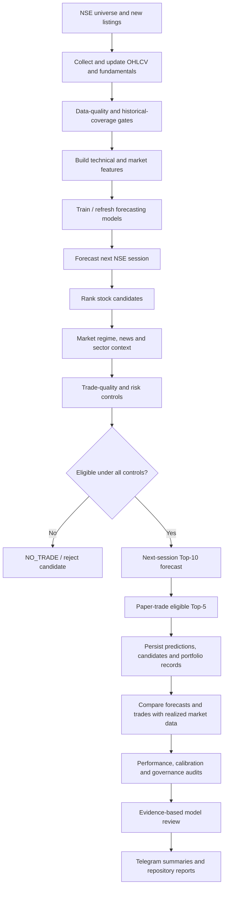

# Stock Picker

An automated Indian-equity research and paper-trading system for the NSE market. It maintains a stock universe, collects and validates market data, builds next-session forecasts, ranks candidates, applies market and trade-risk controls, tracks simulated trades, and continuously evaluates model quality.

The system is designed as an evidence-driven decision-support workflow. A model prediction is not a promise of return, and a candidate is not automatically a trade.

## What the model does

The workflow combines several layers:

- **Market universe:** Maintains the Nifty 500 constituent universe and a separate watchlist for newly listed securities.
- **Historical market data:** Collects daily OHLCV data and corporate actions, maintains the historical store, and audits coverage against NSE trading sessions.
- **Technical features:** Builds price, momentum, trend, volatility, range and volume features from historical bars.
- **Forecasting:** Trains and refreshes the core forecasting models and produces next-session OHLC forecasts for eligible stocks.
- **Stock ranking:** Scores and ranks the universe using forecast and market features, with dedicated challenger models evaluated separately.
- **Market context:** Adds index/regime intelligence, sector context and available news information to the decision process.
- **Risk and trade quality:** Applies expected-return, volatility, risk/reward, position-size and portfolio-risk checks. The system can return **NO_TRADE** when conditions do not meet its controls.
- **Paper trading:** Records simulated trade decisions, quantities, capital allocation, costs, exits and portfolio results. Paper-trading results are measurement evidence, not live broker executions.
- **Evaluation and governance:** Compares forecasts with realized prices, tracks longer-horizon outcomes, audits performance and keeps challenger models behind evidence and authorization gates.
- **Reporting:** Publishes workflow results and market/paper-trading summaries through configured Telegram notifications.

## End-to-end workflow

### Daily production cycle

The main GitHub Actions workflow runs on NSE trading days after the market close (scheduled for 16:00 India time). Its high-level sequence is:

1. Validate source code, regression tests and integration wiring.
2. Build and validate challenger components for new listings, ranking, trade quality, directional accuracy and confidence.
3. Refresh the NSE universe and market history, then enforce completed-session data-quality checks.
4. Evaluate the previous prediction against realized OHLC data.
5. Retrain the core models on available realized history and generate the next trading-session forecast.
6. Refresh candidate-selection validation and longer-horizon prediction outcomes.
7. Build index intelligence and market-regime context.
8. Run paper-trading benchmarks, portfolio comparisons and strategy governance checks.
9. Run the performance, forecast, accounting, risk, data-quality and promotion-evidence audits.
10. Run final integration and promotion gates, send configured Telegram reports, and commit generated records.

The workflow also supports a controlled manual run. Its `reuse_stored_data` option skips the new model/data-generation portion and refreshes downstream reporting from stored artifacts; it is not equivalent to a fresh market-data run.

## Model and decision layers

### Core forecasting

The core pipeline creates historical features per stock, trains forecasting estimators, and predicts the next completed NSE session. Forecasts are stored with the prediction date, target date, symbol, rank, base close and predicted OHLC values. Predictions are later joined to actual market bars for error and directional evaluation.

### Ranking and challengers

Separate ranking, directional, confidence, new-listing and trade-quality components provide additional signals and challenger evidence. Their validation is tracked independently. A challenger is not automatically the production model merely because it can train or produce a score.

### Market regime and risk

Index intelligence provides broad-market and sector context. Risk controls can reduce or reject exposure based on market risk, expected return, volatility, risk/reward, trade quality, position sizing and portfolio limits. A defensive market state must not silently fall back to an unrestricted selection.

### Paper-trading lifecycle

The paper-trading layer records simulated entries and exits, share quantities, allocated capital, gross and net P&L, estimated costs and exit reasons. The V2 paper-trading path is maintained as a separate benchmark/shadow path while promotion evidence is collected.

## Automated operating schedule

| Workflow | Schedule | Purpose |
|---|---|---|
| Main Stock Picker | Monday–Friday, 16:00 IST | Daily data refresh, prediction, evaluation, paper trading, audits and reporting |
| Weekend Data Quality Audit | Saturday, 09:00 IST | Audit collected and model artifacts; refresh source-backed market/fundamental data and publish reports |
| Historical OHLCV Recovery | Manual or recovery-triggered | Recover historical market data and produce per-stock coverage reports |
| Pipeline Integrity CI | On relevant code changes | Syntax, integration preflight and regression tests |
| Forecast / ranking validation CI | On relevant code changes | Protect specialized model and ranking logic with tests |

All schedules are GitHub Actions schedules and may start later than the nominal time due to GitHub-hosted runner availability.

## Data and audit trail

The repository keeps the model's working history and evidence in versioned data artifacts. Important records include:

| Artifact | Role |
|---|---|
| `data/universe.csv` | Current stock universe |
| `data/new_listings.csv` and history | Recent listing watchlist and its history |
| `data/ohlcv.csv` | Historical daily market bars and corporate actions |
| `data/fundamentals.csv` and history | Current and historical fundamental snapshots |
| `data/predictions.csv` | Persisted next-session forecasts |
| `data/prediction_candidates_history.csv` | Candidate universe and selection metadata by prediction vintage |
| `data/evaluations.csv` | Forecasts matched with realized OHLC outcomes |
| `data/prediction_outcomes.csv` | Longer-horizon outcome tracking |
| `data/paper_trades.csv`, `data/paper_trades_v2.csv` | Simulated trade lifecycle and accounting |
| `data/portfolio_daily.csv` and V2 equivalent | Simulated portfolio history |
| `data/historical_coverage_audit.*` | Per-stock history depth and NSE-session coverage |
| `data/weekend_data_quality_audit.*` | Weekend audit of collected data and model artifacts |
| `data/phase114_promotion_readiness_summary.json` | Evidence and authorization status for production promotion |

Generated records are committed by the workflows so that predictions, evaluations, paper-trading decisions and audit results can be reviewed over time.

## Data integrity and recovery policy

- Market history is refreshed from external market-data sources; missing prices are not interpolated or fabricated.
- OHLC values are checked for finite, positive and internally consistent prices before use.
- Historical gaps are compared with the NSE exchange calendar and reported per symbol.
- Corporate actions are retained as part of the market-history record.
- Weekend audits inspect collected data and model artifacts. Source-backed market data may be refreshed; missing predictions, model outputs or accounting facts are reported rather than guessed.
- A newly listed stock is not expected to have years of pre-listing history. Its available history must be interpreted in the context of its actual listing date.
- A successful workflow run means its configured steps completed; it does not by itself prove forecast skill or profitability.

## Model governance and promotion policy

The production champion and challenger models are deliberately separated. Challenger results are evaluated in shadow/diagnostic mode until sufficient independent, chronological evidence is available and the promotion gates explicitly authorize a change.

Promotion evidence considers, among other things:

- Matched predictions and actual outcomes across enough sessions and observations.
- Chronological and walk-forward validation without future-data leakage.
- Forecast accuracy and comparison with simple baselines.
- Risk-adjusted paper-trading results after realistic costs.
- Trade lifecycle, exit-reason and P&L reconciliation.
- Stability across market regimes and symbols.
- Data completeness, selection integrity and operational reliability.

Automatic promotion is not assumed. If evidence is insufficient, the safe outcome is to retain the existing champion or make no trade.

## Notifications and operational outputs

The daily workflow can send the next-session Top-10 forecast, previous-session forecast evaluation, completed Top-5 paper-trading result and V2 risk-gated paper-trading summary to Telegram. Delivery records are retained to prevent duplicate notifications and to distinguish API-confirmed delivery from unverified legacy records.

## Current development status

This repository is under active development. Historical data quality, candidate-history coverage, realized outcome collection, broker-cost verification, historical ledger reconciliation and sustained challenger validation remain important evidence areas. Reports in the repository should be treated as the authoritative current status; do not infer production readiness from the existence of a model file or a green CI run.

**Intended use:** research, forecasting evaluation and paper trading. This project does not execute live trades or provide guaranteed investment returns.
